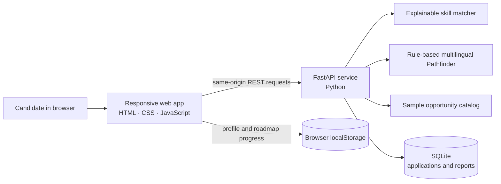
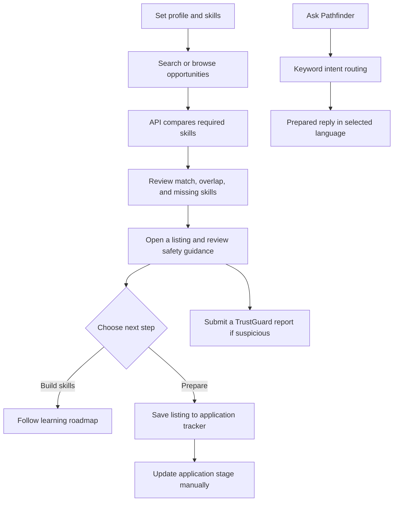
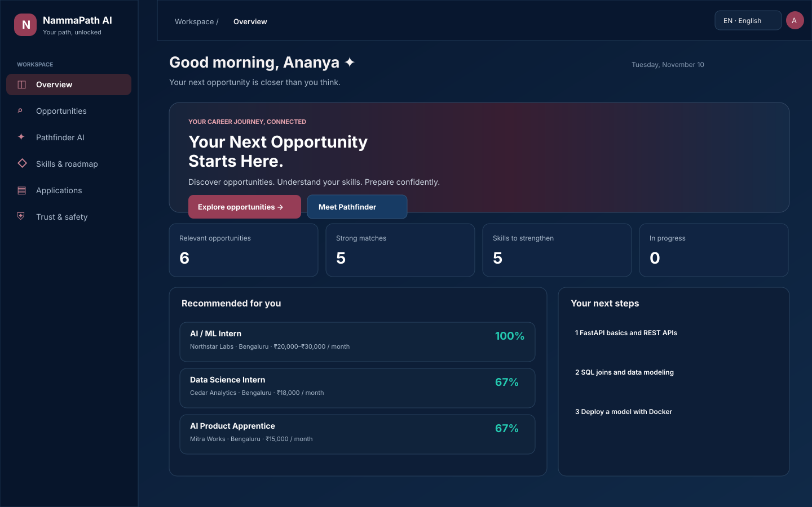
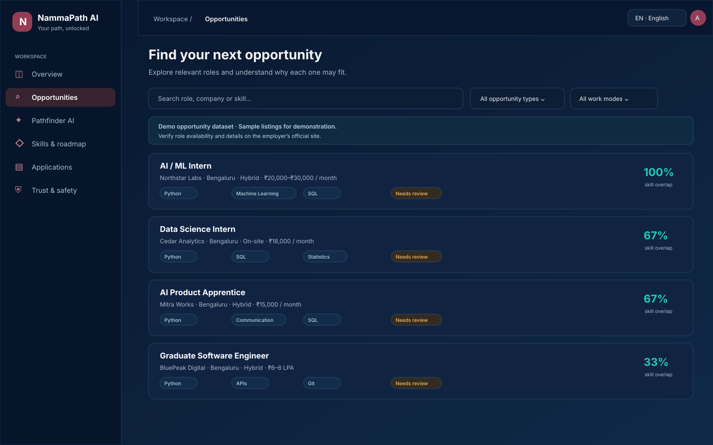
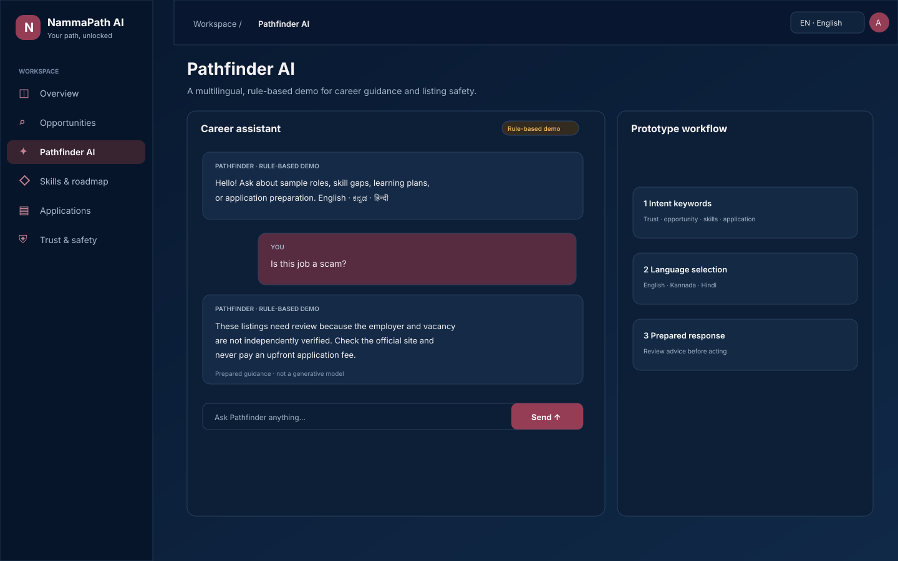
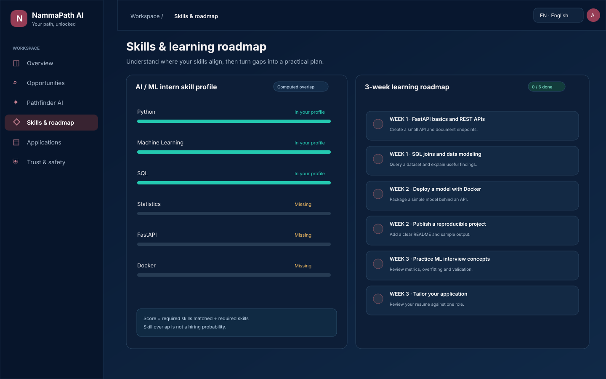
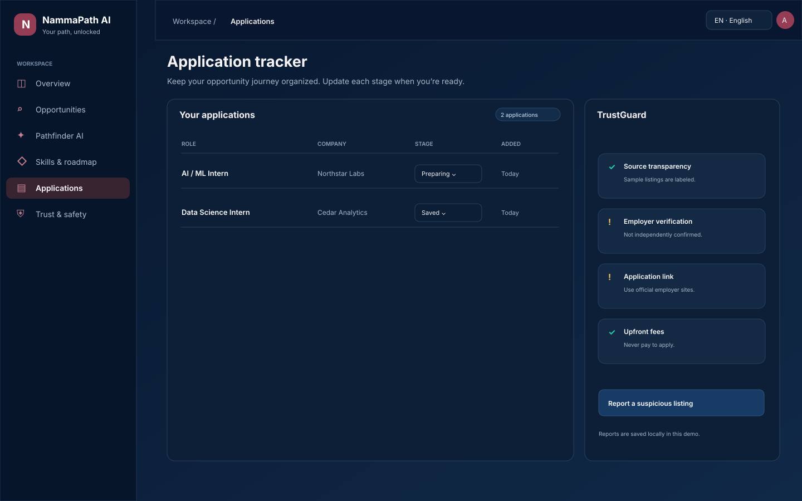

# NammaPath AI

> **Find your path. Unlock your potential.**

NammaPath AI is a Bengaluru-first career opportunity prototype for students, fresh graduates, and local job seekers. It brings opportunity discovery, skill matching, learning guidance, application tracking, and listing-safety advice into one connected experience.

## The problem

People looking for their first role often have to piece together opportunities from many places. They may be unsure whether they meet eligibility requirements, which skills to improve, how to prepare an application, or whether a listing is trustworthy. Language and accessibility barriers can make those steps harder.

## What this prototype does

- Searches a small set of sample internships, graduate roles, and apprenticeships.
- Compares profile skills with each listing’s required skills. **Match score = matched required skills ÷ total required skills.** Missing skills are calculated from the same comparison.
- Suggests a three-week learning roadmap and saves checked items in the browser.
- Tracks opportunities through Saved, Preparing, Applied, Interview, Offer, and Rejected.
- Accepts TrustGuard reports and shows safety guidance.
- Provides prepared English, Kannada, and Hindi responses through a keyword-based assistant.

The opportunity records are fictional demo listings. There is no resume upload, live job feed, employer verification, AI model connection, or automatic application submission in this version.

## Architecture



The browser UI and API are served by the same FastAPI process. Project files are not exposed as a static directory: `/` serves `index.html`, and `/app.js` serves only the frontend script. The API stores application stages and submitted TrustGuard reports in SQLite. Candidate profile preferences and roadmap checkbox progress remain in the browser.

## Candidate journey



## Screen gallery

The following five images are **screen illustrations** of the current interface and its main journeys. They are documentation illustrations, not captured browser screenshots. Run the app locally for the live interactive screens.











## Technology

| Layer | Technology | Role |
|---|---|---|
| UI | HTML5, CSS3, JavaScript | Responsive screens, interaction, API calls |
| API | Python 3.11+, FastAPI, Pydantic | REST routes, validation, matching, assistant responses |
| Persistence | SQLite | Demo applications and TrustGuard reports |
| Local deployment | Uvicorn or Docker | Serves the UI and API from one process |
| Testing | pytest, FastAPI TestClient | API behavior checks |

## Run locally

Requires Python 3.11 or later.

### Windows PowerShell

```powershell
cd NammaPath-AI
py -m venv .venv
.venv\Scripts\Activate.ps1
pip install -r requirements.txt
uvicorn server:app --reload
```

### macOS / Linux

```sh
cd NammaPath-AI
python3 -m venv .venv
source .venv/bin/activate
pip install -r requirements.txt
uvicorn server:app --reload
```

Open `http://127.0.0.1:8000`. Interactive API documentation is at `http://127.0.0.1:8000/docs`. The local server must remain running while using the website. SQLite is created as `nammapath.db`; set `NAMMAPATH_DB` to choose another path.

### Docker for local demonstration

```sh
docker build -t nammapath-ai .
docker volume create nammapath-data
docker run --rm -p 127.0.0.1:8000:8000 -v nammapath-data:/data nammapath-ai
```

The container runs as an unprivileged user, and the named volume persists SQLite data. `.dockerignore` excludes local databases, virtual environments, and test files. CORS allows the local development origins by default; set `NAMMAPATH_CORS_ORIGINS` to a specific comma-separated allowlist if needed.

## API reference

| Method | Route | Purpose |
|---|---|---|
| `GET` | `/api/health` | Health and service date |
| `GET` | `/api/opportunities?q=&type=&mode=&skills=` | Search listings and compute skill overlap |
| `GET` | `/api/opportunities/{id}?skills=` | Listing detail and computed match |
| `GET` | `/api/roadmap` | Three-week demo roadmap |
| `POST` | `/api/pathfinder` | Prepared multilingual reply for a message, language, and skills |
| `GET`, `POST` | `/api/applications` | List tracked items or add a listing |
| `PATCH`, `DELETE` | `/api/applications/{id}` | Update stage or remove an item |
| `POST` | `/api/reports` | Save a TrustGuard report |

Reports have no public list endpoint. Applications are global to this single-user demo because authentication and account isolation are not implemented.

## Matching and assistant behavior

The matcher trims skill values and compares them case-insensitively. For a listing requiring `Python`, `Machine Learning`, and `SQL`, a profile containing `Python` and `SQL` receives `2 / 3 = 67%`; the missing skill is `Machine Learning`. A score describes skills only. It is not a hiring probability or eligibility decision.

Pathfinder is explicitly a **rule-based demo assistant**. It uses simple keyword intent routing and prepared responses in English, Kannada, and Hindi. The response does not come from a generative model and specialist AI agents are not running behind the interface.

## Trust, privacy, and demo limits

- Sample employers and roles are fictional, not current vacancies or verified employers. Deadlines are generated relative to the current date.
- Confirm job details on an employer’s official site. Never pay an upfront application or interview fee.
- There is no authentication, per-user isolation, resume handling, or production security review. Do not enter sensitive personal data or expose this prototype publicly.
- The demo does not automatically apply to jobs or make candidate decisions.
- The API does not expose project files through a static mount. CORS is restricted to local origins by default.

Before a multi-user or public deployment, add authentication and authorization, per-user records, protected resume storage, a production database, rate limiting, logging/privacy controls, security review, and verified opportunity sources.

## Tests

```sh
python -m pip install -r requirements-dev.txt
pytest
```

The API tests cover computed matching and gaps, language-aware intent replies, tracker persistence, report access, and static-file exposure.

## Repository layout

```text
NammaPath-AI/
├── index.html                 # Page structure and visual design
├── frontend.js                # Browser behavior and API integration
├── server.py                  # FastAPI routes, matcher, SQLite persistence
├── tests/test_api.py          # API tests
├── docs/screenshots/          # README screen illustrations
├── requirements.txt
├── requirements-dev.txt
├── Dockerfile
├── .dockerignore
└── README.md
```
